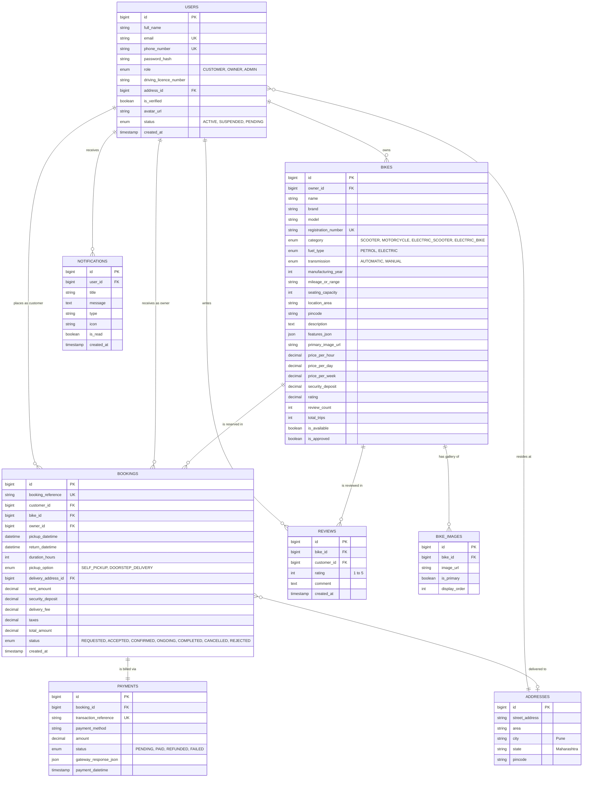

# PedalPal Entity-Relationship (ER) Diagram

## Entity Cardinalities & Relationships
1. **User to Bike (1 : N)**: One owner lists 0, 1 or many bikes. Each bike is owned by exactly 1 registered user with role `OWNER`.
2. **User to Booking (1 : N)**: A customer can place multiple bookings over time. An owner receives multiple rental booking requests.
3. **Bike to Booking (1 : N)**: A single bike can be booked for multiple distinct, non-overlapping rental time slots.
4. **Booking to Payment (1 : 1)**: Each rental booking corresponds to a unique payment lifecycle record.
5. **Bike to BikeImage (1 : N)**: A bike listing contains a primary image and optional secondary angle photographs.
6. **Bike to Review (1 : N)**: A bike accumulates verified reviews from customers who booked it.
7. **User to Notification (1 : N)**: Each notification belongs strictly to its target recipient user.
