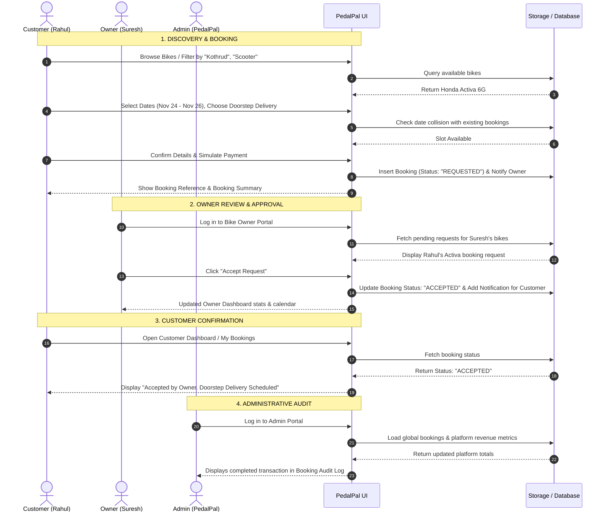

# PedalPal - Application Workflows

## 1. End-to-End User Journey: Customer to Owner to Admin

## 2. Key Workflow Lifecycles

### 2.1 Booking State Machine
1. **REQUESTED:** Customer submits booking request.
2. **ACCEPTED:** Owner approves the request.
3. **CONFIRMED:** Doorstep delivery or pickup scheduled.
4. **ONGOING:** Customer checks in vehicle with photo check and takes keys.
5. **COMPLETED:** Vehicle returned safely; security deposit automatically refunded.
6. **CANCELLED:** Customer or owner cancels before handover; deposit refunded.
7. **REJECTED:** Owner declines booking due to schedule conflicts; full refund.

### 2.2 Owner Listing Lifecycle
1. Owner fills out `add-bike.html` form with specs and photos.
2. System validates registration number and sets `is_approved = true` (or pending admin review).
3. Bike immediately appears in explore search and customer catalog.
